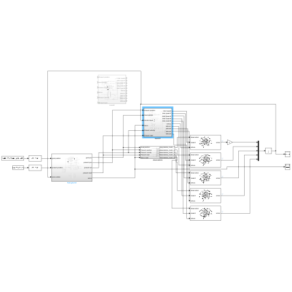
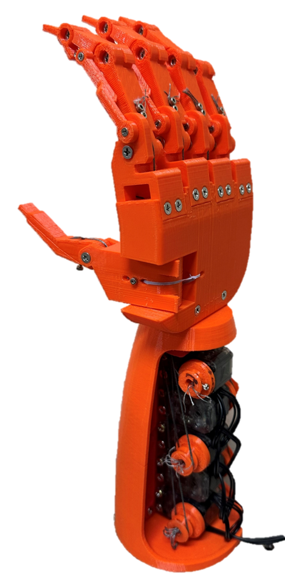
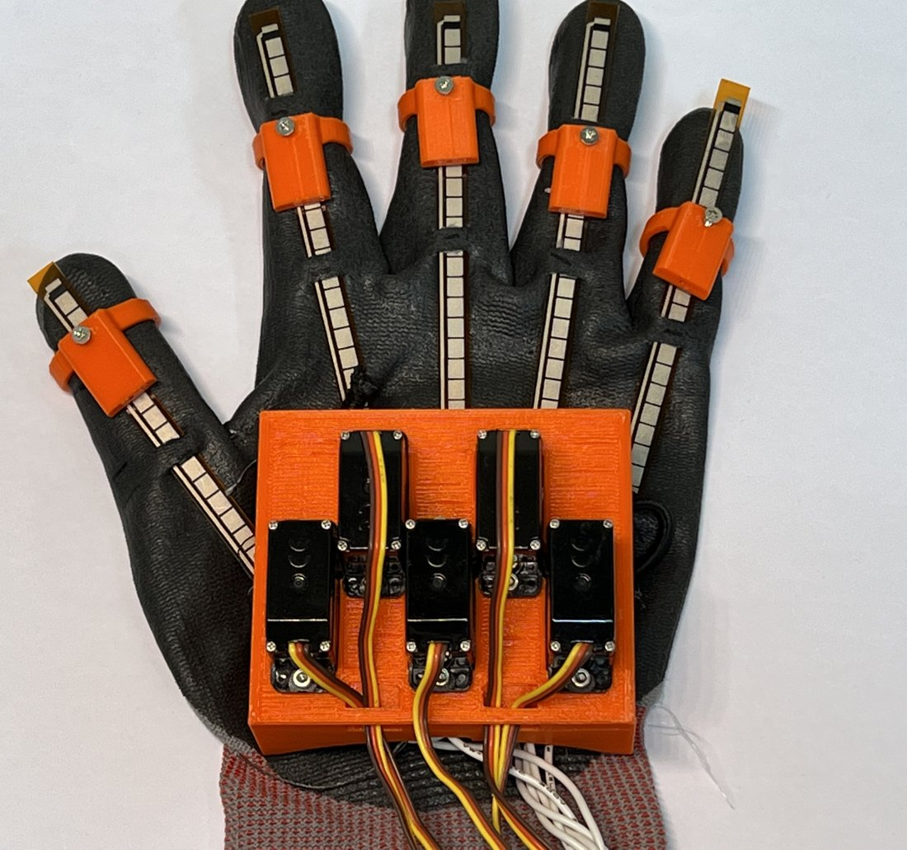
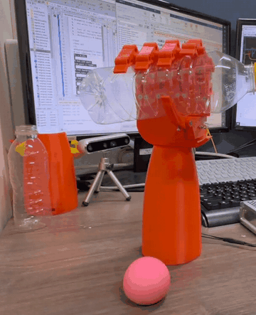
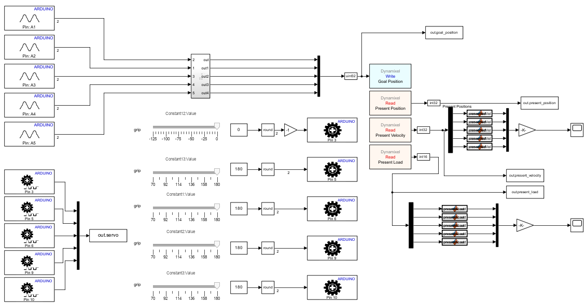
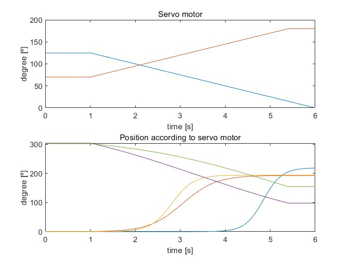
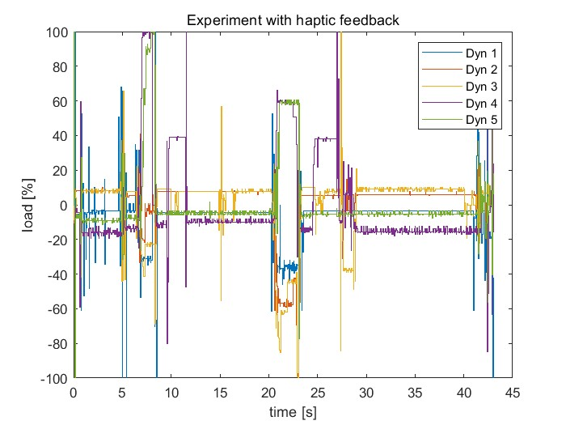

# Robot-hand grasping with multi-agent DDPG in Simulink

MATLAB / Simulink code for haptic-feedback grasping with a five-finger robot hand built in our lab as a prosthetic-hand prototype and operated through a glove-type controller.
Five DDPG agents, one per feedback servo of the glove, are trained on a Simulink model that replays logged goal and present positions of the hand's motors, estimates motor load with regression functions and velocity by differentiation, and rewards each agent for tracking the goal position without exceeding a load limit.
The repository also holds the hardware-interface scripts and models used to log the data and to run the agents on the hardware, and the scripts that fit the regression functions.
Author: Do-Gyeong Yuk.

  
   
  Overview of the Simulink model with the five RL Agent blocks.

## Publications

- D.-G. Yuk, J. W. Sohn, "Haptic-based Robot Hand Grasping Technique Using Reinforcement Learning," Proc. SPIE Smart Structures + NDE 2024. https://doi.org/10.1117/12.3010674

## Figures

<table>
  <tr>
    <td align="center" width="24%"> Robot hand with its actuators, photo from slide 18 of the SPIE 2024 slides.</td>
    <td align="center" width="38%"> Glove-type controller with a flex sensor on each finger and the feedback servos on the back of the hand, photo from slide 19 of the SPIE 2024 slides.</td>
    <td align="center" width="38%"> Robot hand holding a water bottle and then a soft object in the experiment with partial haptic feedback (cropped from the video on slide 37 of the SPIE 2024 slides; three segments joined, 2x speed).</td>
  </tr>
</table>

  
   
  Data-acquisition model from slide 30 of the SPIE 2024 slides, the layout of <code>hardware/original_model_robot_hand4_pos_percent.slx</code>: flex-sensor inputs on Arduino analog pins set the Dynamixel goal positions, present position, velocity and load are read back, and sliders set the servo angles.

<table>
  <tr>
    <td align="center" width="50%"> Servo-motor angle ramps (top) and the position according to the servo motor given by the robot hand model (bottom), from slide 32 of the SPIE 2024 slides.</td>
    <td align="center" width="50%"> Load of the five Dynamixel motors (Dyn 1 to Dyn 5, in percent) over time in the experiment with haptic feedback, from slide 37 of the SPIE 2024 slides.</td>
  </tr>
</table>

## Repository structure

| Path | Purpose |
| --- | --- |
| `rl_model.m` | Builds the observation and action specifications, the actor and critic networks and five DDPG agents, and starts multi-agent training. |
| `reinforcemen_model2.slx` | Simulink model referenced by `rl_model.m`: environment subsystem, observation and reward subsystems and five RL Agent blocks. |
| `later_revisions/rl_model.m` | Later revision of the training script (saved 2024-03-23), which references `reinforcemen_model4`. |
| `later_revisions/reinforcemen_model4.slx` | Revision 5.27 (2024-03-23) of the model that the later training script references. |
| `later_revisions/reinforcemen_model5.slx` | Revision 5.29 (2024-04-10), the training model shown on slide 31 of the SPIE 2024 slides; no script in this repository references it. |
| `hardware/dynamixel_basic_code.m` | Serial test for one Dynamixel motor: enables torque, writes a goal position and reads the present position. |
| `hardware/readWord.m`, `hardware/writeByte.m`, `hardware/writeWord.m` | Packet helpers called by `dynamixel_basic_code.m`. |
| `hardware/dynamixel_library_derived/dynamixel_connect_code.m` | Session script for the hardware models, modified from the `ReadWrite.m` Simulink example of the Dynamixel Library for MATLAB and Simulink. |
| `hardware/dynamixel_library_derived/LICENSE` | BSD 3-Clause license of that library, which applies to `dynamixel_connect_code.m`. |
| `hardware/baudrate.m` | Commands that read and set the serial baud rate of the Arduino target of the current model. |
| `hardware/initial_set_code.m` | Computes the gain and bias that map each flex-sensor range to a goal-position range, and plots the logged signals. |
| `hardware/data_inspection.m` | Converts a logged run to signed load and plots position error and load. |
| `hardware/original_model_robot_hand4_pos_percent.slx` | Data-acquisition model: flex sensors to Dynamixel goal positions, Dynamixel read-back, servo sliders and logging of five signals. |
| `hardware/original_model_robot_hand5_servo_1.slx` | Revision of the data-acquisition model that the metadata of `data/traindataset*.mat` names as the source of the log (state of 2024-03-21). |
| `hardware/reinforcemen_model_realtest.slx` | Hardware model in which five RL Agent blocks read the measured signals and write their actions to the five servos. |
| `modelling/calculateGoalPositionFromServoAngle.m`, `modelling/calculateServoAngleForGoalPosition.m` | Linear conversion from servo angle to goal position, and its inverse. |
| `modelling/curvefitting_for_servo.m` | Fits a logistic function from servo angle to goal position by nonlinear least squares. |
| `modelling/nonlinearRegressionModel.m` | The logistic function with the parameters that the Simulink models use for servo 1. |
| `modelling/adjustGoalPosition1.m` | Limits a goal position with a logistic bound that depends on the servo angle. |
| `modelling/diff_load_linear_regression_code.m` | Fits one linear model per motor from position difference to present load and plots prediction against measurement. |
| `archive/reinforcemen_model.slx` | Earlier revision of the model with a simpler environment subsystem. |
| `archive/reinforcemen_model4.slx` | Revision 5.26 of `reinforcemen_model4` (the copy in `later_revisions/` is revision 5.27), with a different reward and a fixed-step solver. |
| `archive/curvefitting_for_servo.asv` | MATLAB autosave of `curvefitting_for_servo.m` from 2024-03-22 that still contains five `fitlm` calls for the linear load model. |
| `data/traindataset.mat`, `data/traindataset_new.mat` | Logged goal and present positions of the five motors, replayed by the model. |
| `docs/model_overview.png` | Thumbnail of the model diagram. |
| `docs/` (other files) | Photos, GIF, model diagram and plots shown under Figures. |

## How it works

### System

- According to the SPIE 2024 slides, the fingers of the robot hand are driven by Dynamixel motors, and the glove-type controller has a flex sensor on each finger and feedback servos on the back of the hand that are connected to the fingers with wires.
- In the hardware models the five flex-sensor signals are read on Arduino analog inputs, scaled and written to the five Dynamixel motors as goal positions.
- Present position, present velocity and present load are read back from the Dynamixel motors.
- The five servo angles are written through Arduino Standard Servo Write blocks, from sliders in the data-acquisition model and from the agents in `reinforcemen_model_realtest.slx`.
- In the code, "servo" therefore denotes a feedback servo of the glove, and goal position, present position, present velocity and present load denote signals of the Dynamixel motors of the robot hand.

### Hardware interface (`hardware/`)

- `dynamixel_basic_code.m` opens a serial port, enables torque, writes one goal position, waits and reads the present position through `writeByte`, `writeWord` and `readWord`.
- The three helpers build packets that start with two header bytes of 255, followed by motor ID, length, instruction, address, data and a checksum byte.
- `dynamixel_connect_code.m` opens the port, sets the baud rate and finds the motors, which creates the workspace variables `Ts`, `lib_name`, `port_num`, `protocol_version`, `motor_IDs` and `motor_models` that the Dynamixel Read and Write blocks take as parameters.
- Its last section disables torque and closes the port.
- Compared with the upstream example, the script adds the SDK path, changes the sample time and the port, and leaves out the operating-mode, drive-mode and torque-enable calls.
- In the hardware models each flex-sensor signal passes a moving average, a gain and bias, a saturation and a dead-zone function that holds its output until the input has changed by more than a set percentage.
- `initial_set_code.m` computes such gains and biases from the lower and upper value of each sensor signal and the wanted goal-position range.
- Raw load and velocity values of 1024 or more are mapped to negative values in MATLAB Function blocks, and `data_inspection.m` applies the same mapping to the load of a logged run.
- `original_model_robot_hand5_servo_1.slx` logs goal position, present position, present velocity and present load, and contains a commented-out branch that ramps the servo angles.
- `reinforcemen_model_realtest.slx` takes its five agents from the workspace variable `saved_agent` and writes each action, delayed by one sample and rounded, to one servo.

| Item | Value | Where |
| --- | --- | --- |
| Serial port / baud rate, single-motor test | `COM7` / 57600 | `dynamixel_basic_code.m` |
| Motor ID, single-motor test | 3 | `dynamixel_basic_code.m` |
| Control-table addresses: torque enable / goal position / present position | 24 / 30 / 37 | `dynamixel_basic_code.m` |
| Goal-position range named in the comment | 0 to 1023 | `dynamixel_basic_code.m` |
| Serial port / baud rate / protocol version, Simulink session | `COM9` / 57600 / 2 | `dynamixel_connect_code.m` |
| Sample time `Ts` of the Dynamixel blocks | 0.05 s | `dynamixel_connect_code.m` |
| Arduino board / host port in the model configuration | Arduino Uno / `COM11` | hardware models |
| Baud rate set for the Arduino target | 921600 | `baudrate.m` |
| Analog input pins of the flex sensors / sample time | 1 to 5 / 0.05 s | hardware models |
| Servo pins | 3, 5, 6, 9, 10 | hardware models |
| Moving-average window of the flex-sensor signals | 3 samples | hardware models |
| Servo slider ranges (servo 1 / servos 2 to 5) | -125 to 0 / 70 to 180 | `original_model_robot_hand4_pos_percent.slx` |
| Gain applied to converted load | 0.0977 | hardware models, `data_inspection.m` |

### Regression functions (`modelling/`)

- `calculateGoalPositionFromServoAngle.m` is a straight line through two points of servo angle and goal position, and `calculateServoAngleForGoalPosition.m` is its inverse with the result limited to the servo range.
- `curvefitting_for_servo.m` fits `a / (1 + exp(-c*(x-b)))` with the servo angle as `x` and the goal position as `y`.
- `nonlinearRegressionModel.m` holds this function with the same three parameters as the MATLAB Function block for servo 1 in `reinforcemen_model2.slx`.
- In `reinforcemen_model2.slx` the logistic functions give the goal position from the servo command, and in the two models in `later_revisions/` they give a bound on the logged goal position, as in `adjustGoalPosition1.m`.
- `diff_load_linear_regression_code.m` fits `present_load` against `pos_diff` with `fitlm`, one model per motor, and plots the fitted line against the measured load.
- The linear load functions in the Simulink models have this form, with the output limited to a symmetric range.

| Item | Value |
| --- | --- |
| Points of the linear conversion (servo angle, goal position) | (0, 920) and (125, 18) |
| Servo range of the inverse conversion | 0 to 125 |
| Logistic parameters `a`, `b`, `c` in `nonlinearRegressionModel.m` | 756, 28.73, -0.1959 |
| Start point of the logistic fit (`a`, `b`, `c`) | 916, 66, 0.01 |
| Logistic parameters `a`, `b`, `c` in `adjustGoalPosition1.m` | 951.8, 39.32, -0.1098 |
| Rows used by the `fitlm` calls in `archive/curvefitting_for_servo.asv` | 401 to 590 |

### Agents (`rl_model.m`)

- Five agents are created, `agentA` for servo 1 (action `servo1`) and `agentB` to `agentE` for servos 2 to 5 (action `servo2to5`).
- Each agent receives a five-element observation and outputs one scalar servo command.
- Every agent is a DDPG agent with a deterministic actor and a Q-value critic built as `dlnetwork` objects.
- The actor ends in a `tanh` layer followed by a scaling layer that maps the output to the action range.
- Training uses `rlMultiAgentTrainingOptions` with agent 1 in its own group (decentralized) and agents 2 to 5 in one group (centralized).

| Item | Value |
| --- | --- |
| Sample time `Ts` / episode length `Tf` | 0.1 s / 17 s |
| Observation size per agent | 5 |
| Action range, servo 1 | -125 to 0 |
| Action range, servos 2 to 5 | 70 to 180 |
| Actor layers | 5 - 100 - 100 - 50 - 1, `tanh` activations |
| Actor output scaling, servo 1 | scale 62.5, bias -62.5 |
| Actor output scaling, servos 2 to 5 | scale 55, bias 125 |
| Critic state path | 5 - 100 (ReLU) - 100 |
| Critic action path | 1 - 100 |
| Critic common path | addition, sigmoid, 50, sigmoid, 1 |
| Critic / actor learning rate | 1e-3 / 1e-4 |
| Gradient threshold | 1 |
| Experience buffer length | 1e6 |
| Discount factor | 0.99 |
| Mini-batch size | 64 |
| Exploration noise variance / decay rate | 0.6 / 1e-5 |
| Maximum episodes | 5000 |
| Score averaging window | 400 |
| Stop criterion (average reward) | 1000 |
| Save criterion (episode reward) | 380 |

### Simulink model (`reinforcemen_model2.slx`)

- Two From Workspace blocks read `outCopy.goal_position` and `outCopy.present_position`, each with five channels.
- The five agent actions are multiplexed, delayed by one sample and fed to the environment subsystem `Subsystem3`; the action of agent 1 is negated first.
- `Subsystem3` uses the agents' servo commands when the logged position error is at or above a threshold and constant servo values otherwise.
- In the same condition the goal position is taken from the servo commands through one logistic function per servo, and otherwise from the logged goal position.
- The present load of each servo is a linear function of goal position minus present position, limited to a symmetric range.
- The present velocity is the time derivative of the scaled present position.
- The `observations` subsystem builds, for each servo, the vector of goal position, present position, present velocity, present load and servo command.
- The `reward1` subsystem outputs one reward and one termination flag per agent.

| Reward term (per servo) | Form |
| --- | --- |
| Position tracking | reciprocal of (absolute position error + block-default constant) |
| Velocity | reciprocal of (absolute velocity + block-default constant) when the absolute velocity is at most 3, otherwise 0.01 |
| Load change | reciprocal of (absolute change of the positive load between samples + block-default constant) |
| Overload penalty | -500 while the positive load exceeds 100 |
| Termination flag | set while the positive load exceeds 100 |

| Environment constant | Value |
| --- | --- |
| Position-error threshold for using agent commands | 15 |
| Constant servo values otherwise (servo 1 / servos 2 to 5) | 125 / 70 |
| Load limit of the linear load functions | -100 to 100 |
| Position scale before differentiation | 0.29 |
| Velocity divisor | 13.063 |
| Mirror offset for servos 4 and 5 | 1023 |
| Model stop time | 17 s |

### Later revisions (`later_revisions/`)

- The later training script differs from `rl_model.m` only in the values listed below.
- In both later models the environment subsystem limits the logged goal position with one logistic bound per servo, computes the load with the same linear functions and has manual switches that replace the agent actions by constants or ramps.
- Their `reward1` subsystems have no termination and use the terms listed below, with the positions of servos 4 and 5 mirrored first.
- The reward formula on slide 35 of the SPIE 2024 slides lists five terms of the kind used in `reinforcemen_model5.slx`: position difference, position reversal, velocity, load and servo difference.
- `hardware/reinforcemen_model_realtest.slx` uses the same reward terms and weights as `reinforcemen_model5.slx`.

| Item | `rl_model.m` | `later_revisions/rl_model.m` |
| --- | --- | --- |
| Model referenced | `reinforcemen_model2` | `reinforcemen_model4` |
| Sample time `Ts` | 0.1 s | 0.05 s |
| Action range, servo 1 | -125 to 0 | 0 to 125 |
| Actor output bias, servo 1 | -62.5 | 62.5 |
| Maximum episodes | 5000 | 10000 |
| Stop criterion (average reward) | 1000 | 0 |
| Save criterion (episode reward) | 380 | -10 |

| Reward term (per servo) | `reinforcemen_model4.slx` (revision 5.27) | `reinforcemen_model5.slx` (revision 5.29) |
| --- | --- | --- |
| Position error | minus the absolute difference between present and goal position | the same |
| Direction penalty | -100 while the present position is below the goal position | the same |
| Velocity | minus the absolute velocity | the same |
| Load | minus the load when it is positive, minus 5 times its magnitude when it is negative | minus the load when it is positive, minus 3 times its magnitude when it is negative |
| Servo | none | minus 0.1 times the absolute difference between the servo command and a constant (0 for servo 1, 180 for servos 2 to 5) |
| Termination flag | constant 0 | constant 0 |

| Model setting | `reinforcemen_model4.slx` (revision 5.27) | `reinforcemen_model5.slx` (revision 5.29) |
| --- | --- | --- |
| Fixed step size | 0.05 s | 0.05 s |
| Stop time | 17 s | 7 s |

### Archived revisions

- `archive/reinforcemen_model.slx` subtracts a servo-dependent offset from the logged goal position, has no position-error switch and uses a different overload threshold.
- `archive/reinforcemen_model4.slx` uses a reward made of negative position-error, velocity, load-direction, wrong-direction and servo-deviation terms, has no termination, and adds a manual switch for a ramp servo input.
- `archive/curvefitting_for_servo.asv` starts with five `fitlm` calls on two logged signals, one call per motor, followed by the logistic fit of the saved script.

## Requirements

- MATLAB with Simulink; the models were saved with release R2023b.
- Reinforcement Learning Toolbox (`rlNumericSpec`, `rlSimulinkEnv`, `rlDDPGAgent`, `rlMultiAgentTrainingOptions`, RL Agent block).
- Deep Learning Toolbox (`featureInputLayer`, `fullyConnectedLayer`, `layerGraph`, `dlnetwork`).
- A GPU usable by MATLAB, because actors and critics are created with `UseDevice="gpu"`.
- DSP System Toolbox (Moving Average blocks in the hardware models, Moving Standard Deviation blocks in `reinforcemen_model2.slx`).
- Curve Fitting Toolbox (`fittype`, `fitoptions`, `fit`) and Statistics and Machine Learning Toolbox (`fitlm`) for the scripts in `modelling/`.
- Simulink Support Package for Arduino Hardware (Analog Input, Standard Servo Write and Standard Servo Read blocks) and an Arduino Uno for the hardware models.
- [Dynamixel Library for MATLAB and Simulink](https://www.mathworks.com/matlabcentral/fileexchange/125545-dynamixel-library-for-matlab-and-simulink) (BSD 3-Clause), which provides the `dxlSimLibrary` Read and Write blocks and the functions called by `dynamixel_connect_code.m`; it is not included.
- The C library of the [DynamixelSDK](https://github.com/ROBOTIS-GIT/DynamixelSDK), which `dynamixel_connect_code.m` adds to the MATLAB path; it is not included.
- `dynamixel_basic_code.m` uses the `serial`, `fopen` and `instrfind` serial-port functions of MATLAB.

## Running

- Place `rl_model.m` and `reinforcemen_model2.slx` in the same folder or on the MATLAB path.
- Load `data/traindataset.mat` or `data/traindataset_new.mat` so that the variable `outCopy` exists in the base workspace.
- Run `rl_model.m`; with `doTraining = true` it calls `train` on the five agents.
- `later_revisions/rl_model.m` is run in the same way from its own folder, next to the `reinforcemen_model4.slx` it references.
- For the hardware models, set the SDK path and the port in `dynamixel_connect_code.m` and run its first section, up to the `%% End Session` marker, before starting a model.
- Run the last section of `dynamixel_connect_code.m` after the session to disable torque and close the port.
- The hardware models return their logged signals in the variable `out`.
- `reinforcemen_model_realtest.slx` additionally needs a `saved_agent` array of five trained agents in the workspace.
- `diff_load_linear_regression_code.m` expects `out.pos_diff` and `out.present_load`, and `curvefitting_for_servo.m` expects a log with `servo_in` and `goal_position`.

## Data

- `data/traindataset.mat` and `data/traindataset_new.mat` each hold `outCopy`, a log of a run of the robot hand hardware (March 2024).
- Each file holds one `Simulink.SimulationOutput` with the signals `goal_position`, `present_position`, `present_load` and `present_velocity`.
- The metadata stored in both files names `original_model_robot_hand5_servo_1` as the model that produced the log.
- Not included: trained agents and training logs.
- Not included: the logs used by the regression scripts, and the variant of the hardware model that logged `pos_diff`.

| Property of the log | Value |
| --- | --- |
| Channels per signal | 5 |
| Samples | 376 |
| Sample period | 0.05 s |
| Duration | 18.75 s |

## Notes

- This is research code kept as it was used in 2024 (file dates 2024-01 to 2024-04); it has not been cleaned up or re-tested.
- The comment next to `obsInfo` in `rl_model.m` lists quantities of a different model; the observations actually wired in the Simulink model are the ones listed above.
- Several constants in the reward subsystem are left at the Simulink block defaults and are therefore not stored in the model file.
- The regression parameters inside the MATLAB Function blocks are fixed numbers.
- A MATLAB workspace saved on 2024-03-20, which is not included, holds values that agree with the linear load parameters of the models to three decimal places, in the variables `slope1` to `slope5` and `intercept1` to `intercept5` that the `fitlm` lines kept in `archive/curvefitting_for_servo.asv` assign.
- The saved versions of `modelling/curvefitting_for_servo.m` and `modelling/diff_load_linear_regression_code.m` date from April 2024, after the models.
- `hardware/original_model_robot_hand5_servo_1.slx` is the Simulink backup copy (`.slx.original`) of 2024-03-21 stored under the model's own name; the later working copy, changed into a sweep of one servo, is not included.
- The scripts do not state the Dynamixel model (the address variables in `dynamixel_basic_code.m` only carry the prefix `ADDR_MX_`); MATLAB workspaces saved in March 2024, which are not included, hold `XL320` as the detected model of all five motors.
- The configuration sets of the hardware models contain the placeholder network settings of the Arduino support package (for example the Wi-Fi password `secretPassword`), which are not real credentials.
- `hardware/baudrate.m` and `hardware/data_inspection.m` are working notes that contain lines that are not valid MATLAB statements, and `modelling/curvefitting_for_servo.m` uses the workspace variables `servo4_new4` and `mdl`, which it does not create.
- `dynamixel_connect_code.m` contains an absolute Windows path to the SDK that has to be changed.
- Comments in the scripts and in the MATLAB Function blocks are partly in Korean.
